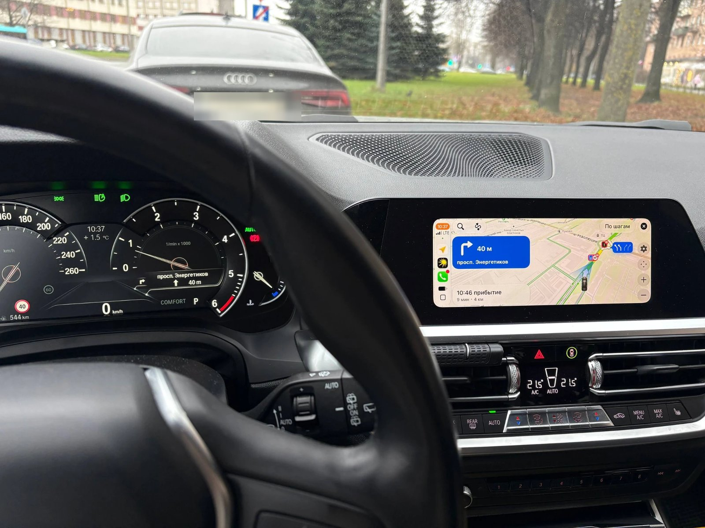

# EntryNav2 CarPlay Cluster

Turn-by-turn maneuver arrows from **Apple CarPlay** on the **instrument cluster** of a BMW with the EntryNav2
(EntryEvo, Cinemo) head unit — where the stock software shows nothing from CarPlay between the dials.

When you navigate with an iPhone over CarPlay (Apple Maps, Google Maps, Waze…), the next-maneuver arrow, the distance
to it and the street name appear on the cluster (DKOMBI2), live from the phone — the slot normally reserved for the
car's built-in navigation.

> Status: working on a BMW G21 (B47) with EntryNav2 + DKOMBI2 and no head-up display. Direction + distance + street are
> live from the phone and persist across reboots.



*The next-maneuver arrow with distance (40 m) and street name (просп. Энергетиков) shown on the cluster, while the
CarPlay map runs on the centre screen. (A nearby car's number plate is blurred.)*

## How it works

```
iPhone ──CarPlay / iAP2──▶ CARPLAY process ──▶ rgd shim (LD_PRELOAD) ──UDP 127.0.0.1:42042──▶ carplay-kombi ──SOME/IP──▶ instrument cluster
                           (stock, Cinemo)      (this repo)                                    (forwarder)              (DKOMBI2)
```

Two parts:

1. **rgd shim** (`rgd/`, this repo) — an `LD_PRELOAD` library injected into the head unit's stock `CARPLAY` process
   (Cinemo iAP2 stack). It (a) declares an iAP2 *Route Guidance Display* component so the phone starts sending
   guidance, (b) subscribes to route-guidance updates, (c) parses the iAP2 `0x52xx` messages
   (Start / Update / Maneuver / Lanes), and (d) emits a tiny UDP datagram to the forwarder. It is defensive: a bounded
   crash-counter stops it re-subscribing after repeated boot-crashes, so it can never loop the car — CarPlay keeps
   working, with or without arrows.
2. **carplay-kombi** — the forwarder that turns a datagram into SOME/IP cluster guidance. It is built from the sibling
   project **[EntryNav2-Android-Auto](https://github.com/Jiraiya43/EntryNav2-Android-Auto)** (the cluster-drawing code
   is shared). This repo documents the datagram contract rather than bundling that binary.

### The datagram contract

`carplay-kombi` listens on `127.0.0.1:42042` and parses `;`-separated single-letter keys:

| key | meaning |
|---|---|
| `G` | guiding, `0`/`1` (1 = a route is active) |
| `T` | Android Auto maneuver type (the shim translates Apple `CPManeuverType` → this with `rgd_apple_to_aa_type`, since the forwarder's cluster table is Android Auto's; the forwarder then maps it to an arrow) |
| `U` | display unit (`1` = metres, `3` = km, tenths) |
| `M` | distance to the maneuver, in metres |
| `D` | distance text to display (e.g. `300`, `1.2`) |
| `R` | road / street name |
| `C` | *(optional)* cue text |
| `E` | *(optional)* roundabout exit number |

Example: `G=1;T=1;U=1;M=280;D=300;R=Hauptstrasse`

See [`docs/maneuver-decode.md`](docs/maneuver-decode.md) for how the Apple maneuver types map to cluster arrows.

## Build & test

The iAP2 parser has host unit tests — no car and no cross-toolchain needed:

```sh
cd rgd && make test
```

The shim itself (`rgd_shim.c` → `carplay-shim.so`) is cross-compiled with the head unit's armhf toolchain and loaded on
the car; it is not built here.

## Install on the car

The head unit is reached over its ENET (OBD-to-Ethernet) cable by SSH. The root password is **never stored in this
repo** — the scripts read it from `$HU_PW` or a git-ignored `.secrets/hu-password.txt`:

```sh
export HU_HOST=169.254.1.0     # your car's ENET address
export HU_PW='…'               # the head unit root password (or put it in .secrets/hu-password.txt)
```

- **Try it (transient, auto-reverts):** `python deploy_sub.py` — uploads the shim, restarts CARPLAY under it, verifies
  it stays up, and auto-reverts to stock if anything is wrong. A reboot wipes it (tmpfs), so it can never get stuck.
- **Make it permanent (survives reboot):** see [`persist/README-persist.md`](persist/README-persist.md) — an AUFS
  update-layer that loads the shim automatically at every boot, with a one-command rollback.
- **Recover:** `python recover.py` (black-screen rescue) · `python kstock.py` (force back to stock).
- **Tune without a restart:** `python cpconf.py KEY=VALUE …` hot-reloads the shim's config (no CARPLAY restart, no
  iPhone unpair).

Safety baked in: graceful `SIGTERM` only (never `kill -9`), single-instance deploy, never interrupt a restart
mid-cycle, and a reboot always falls back to stock.

## Roadmap

Code is present on both ends; these need on-car `0x52xx` captures to finalise the value mappings:

- lane guidance (which lane to take),
- "then…" next maneuver,
- roundabout exit numbers.

A cluster map is a larger, separate investigation.

## Security & secrets

See [`SECURITY.md`](SECURITY.md). The password is not handled by this project beyond reading it from your environment;
`tools/verify_repo.py` (wired as a pre-push hook) refuses to push any commit that contains it, a compiled binary or a
file over 1 MB. Enable the hook once:

```sh
git config core.hooksPath .githooks
```

## Disclaimer

Independent, non-commercial interoperability project. **Not affiliated with or endorsed by BMW, Apple or Cinemo.**
Reverse-engineering here is for interoperability with hardware you own. Modifying a car's head unit carries risk; use
at your own risk, with no warranty. Licensed under **PolyForm Noncommercial 1.0.0** — see [`LICENSE.md`](LICENSE.md).
